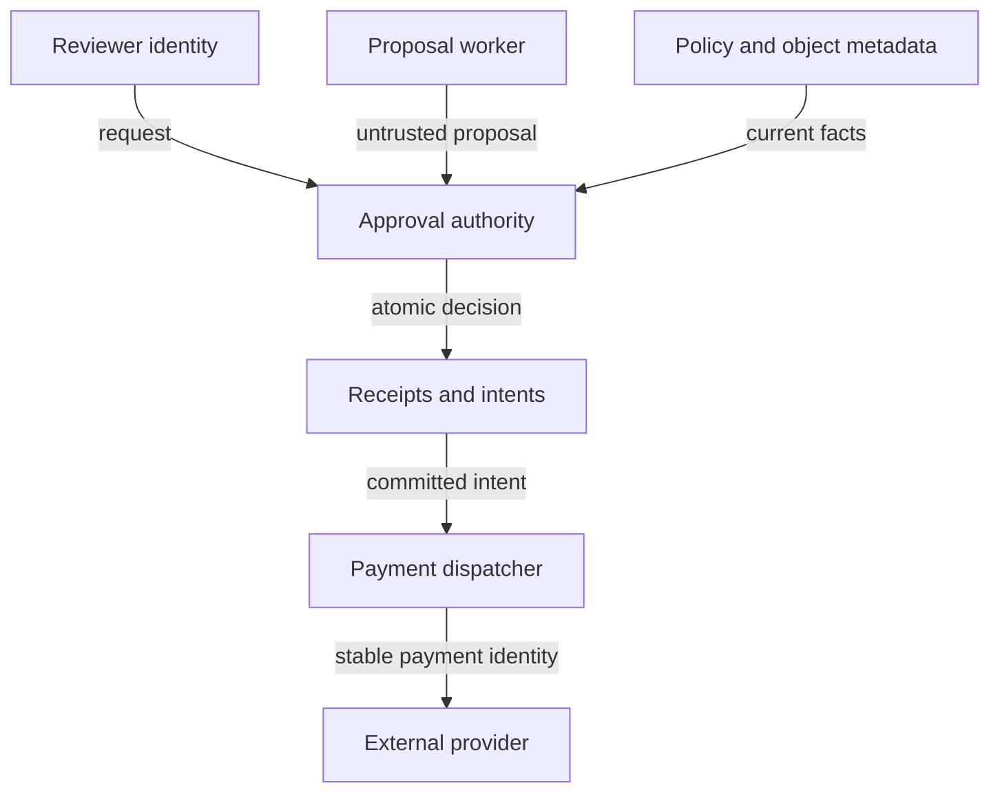

# S06 — Reliability, isolation, and authority boundaries

| Field | Value |
| --- | --- |
| ID / revision / date | S06 · 1.0 · 2026-11-08 |
| Prerequisites | S03 atomic decisions and epochs; S04 failure/replication boundaries; S05 queues and denominators; C01 external effects |
| Capability developed | Define an observable service objective while preserving authority checks and limiting the damage from faulty components |
| Source-check status | R09 chapters 3–4, R11 introductory design principles and R10 placement principle inspected; locators below |
| Experiment status | Executed constructed authorization, budget and scheduling checks; no deployment or security certification |
| Companion | [Hints, worked answers and checks](SDE_S06_answers.md) |

## Two failures that need different repairs

The invoice service sometimes takes too long to return D17's evidence. It also has a dangerous shortcut: a model can propose an approval and the worker executes it using a shared administrator credential. Adding replicas may help the first problem. It can reproduce the second problem more reliably.

A service-level indicator (SLI) is a defined measurement; a service-level objective (SLO) is its target over a declared population and window. Availability concerns whether the service can deliver the intended operation. Authorization concerns whether this principal may perform this action on this object. Authentication establishes the principal's identity; it does not itself grant the action. R09 chapter 4 supplies the measurement terminology; R11 supplies the protection concepts.

Our decision is how to keep useful evidence reads available while ensuring that only an authorized reviewer can create an approval. We will use one control boundary for the approval and separate resource controls for workload isolation. The examples are hypothetical, with no claim about a particular cloud, model or payment provider.

## Map authority before drawing machines

A principal is an accountable identity: a reviewer, a service account or an administrator. A role groups permissions; an object is the resource being accessed. A tenant is the customer boundary in this case. An object ID supplied by a caller is a lookup request, not evidence that the caller owns the object.

| Principal | Permitted operation in this design | Explicit limit |
| --- | --- | --- |
| Tenant A reviewer | Read authorized A evidence; request approval for assigned A documents | Cannot read B evidence or change grants |
| Proposal worker | Read the evidence subset authorized for its job; write a draft proposal | Cannot approve, issue payments or change policy |
| Approval authority | Validate identity, current policy, tenant, epoch, revision and evidence; commit a valid decision | Must not treat proposal text as authorization |
| Payment dispatcher | Execute already committed intents under C01's contract | Cannot invent a new approval or edit its amount |
| Policy administrator | Grant/revoke scoped reviewer access | No automatic payment or evidence access merely from this role |
| Audit reader | Read approved audit metadata | No mutation privilege; raw document access is separate |

The identity and policy stores are trusted inputs. Tenant ownership is read from trusted object metadata. The proposal worker's credential is job-scoped and cannot enumerate every tenant. The approval authority has privileged database access because it must enforce the transition; compromising it is outside the small model and is a major deployment risk. Least privilege reduces that trusted surface rather than making it disappear.

The arrows are allowed interfaces, not proof that an implementation blocks other routes. Evidence reads use a separately mediated read interface and tenant-scoped store access; they are omitted from this diagram to keep its single purpose clear. Test direct database access, batch tools, repair scripts and recovery paths as well as the normal API. A secure button cannot protect an unguarded endpoint.

## The approval boundary and a revocation race

Start from S03's `(epoch=7, revision=2, owner=empty)`. Add policy version v=10, which grants reviewer R approval rights on tenant A's D17. Model a grant revocation as an ordered update to the same authority state as the approval decision. This serialization is a premise of the lesson. A separately cached policy service does not automatically provide it.

For a new approval, the authority evaluates:

`authenticated AND active_grant AND tenant_match AND action_allowed AND current_epoch AND current_revision AND evidence_valid AND slot_empty`.

It takes principal identity from verified execution context, not an `actor` field invented by the model. Exact payload, evidence identity and successful receipt commit with the decision. An existing receipt is returned only after checking current permission to read that historical result; the replay itself creates no new effect. This refines C01's distinction between historical retrieval and fresh approval.

| Ordered event | Current state | Result |
| --- | --- | --- |
| R opens the review page | v=10 grants access | Page displays evidence |
| Administrator revokes R | v=11 removes grant | Revocation commits |
| R's delayed approval arrives with v=10 | Current policy is v=11 | Deny; no owner or intent created |
| R retries unchanged request | Grant still absent | Deny again |

Checking access only when opening the page fails this example. A cached “allowed” answer also fails if it outlives the change. Our rule is that an approval ordered after revocation must not commit for R. If approval commits first, revocation does not undo it or cancel a payment already sent. Cancellation requires its own contract, as C01 established.

To implement the premise, one option is to keep grants and protected decisions in the same serialized authority. Another is a version-validation protocol that atomically rejects a decision if its checked policy version changed before commit. Merely recording the checked version in a log does not enforce this condition. If a product deliberately accepts a bounded stale-permission interval, state that weaker contract and its risks explicitly; do not call it immediate revocation.

The invariant is: every new committed approval has an authorizing grant, matching tenant and valid business state at its decision boundary. Initially no approval exists. A denial changes none of the protected state. The only accepting transition checks the complete predicate and creates a receipt with its policy version. Ordered revocation removes the predicate for subsequent transitions. The proof depends on all writes using that transition and on trustworthy identity/policy data.

R11's fail-safe defaults, complete mediation and least privilege motivate this design. Our serialized revocation mechanism is an original application of those principles. If policy cannot be established, the chosen approval contract denies or defers the mutation; it does not turn a timeout into permission. That can reduce availability while preserving the authority boundary.

## The model proposes; the authority decides

Suppose a model proposes `Approve(tenant=B, D17, actor=admin)` while executing under a tenant A proposal-worker identity. The authority uses the actual principal, observes no approval grant and rejects it. No approval, receipt of acceptance or payment intent is created. Prompt instructions saying “never approve without permission” may guide behavior, but they do not implement the guard.

Checks outside the model include authenticated identity, object ownership, allowed action, current grants, amount/destination constraints, evidence identity, current epoch/revision, duplicate identity and the atomic write boundary. Treat source documents and generated text as data. Neither can grant privileges by asserting that an administrator authorized the operation.

The residual damage matters. A faulty worker can still produce wrong drafts, consume its allocated compute, or leak information already placed in its context through an allowed output channel. Restricting mutation privileges does not prove confidentiality or factual correctness. Limit read scope, destinations, credential lifetime and resource quotas, and evaluate output quality separately. A trusted reviewer can also make a wrong authorized decision; authorization does not establish business truth.

## Define an observable outcome without rewarding denial

For a hypothetical evidence-read service, define a fixed seven-day window and count distinct original read operations received at the instrumented ingress. Eligibility requires supported request shape and a predeclared authorized test/customer cohort for the requested object. Do not remove operations because downstream policy lookup fails or because the service sheds load. Record retries under the original operation ID, starting the clock at its first arrival.

A good operation returns the requested immutable revision with its required evidence reference within two seconds, with no unauthorized disclosure. This checks identity/integrity of the returned evidence, not whether the invoice's assertions are true. In this numerical example all callers retain access throughout the window. In deployment, genuine revoked or forbidden requests belong in a separate policy-outcome population; inability to determine policy must not be disguised as a legitimate exclusion. Keep exclusion counts and reasons independently reviewable.

Set an illustrative SLO of at least 99.5% good operations. In a completed window of 10,000 eligible operations, suppose 9,960 are good, 25 are late and 15 unavailable, with disjoint categories and no security incident. The observed fraction is 99.6%. The allowed bad count is `10,000*(1−0.995)=50`; 40 were used and 10 remain relative to this fixed-window count. This is a request budget, not 0.5% of a week's minutes. Future traffic changes the denominator; the figure is not a fixed forecast of remaining requests.

If retrospective verification identifies 20 additional distinct operations previously counted good as bad, the count becomes 60, the SLI is 99.4%, and the window exceeds its allowance by ten. An original operation that is both late and incorrect is still one bad operation. Summing overlapping error counters would overcount.

A security violation is separately actionable even if the aggregate SLO passes. This design permits no intentional unauthorized approvals or disclosures; an availability error budget is not permission to spend a few data leaks. Zero observed violations also does not prove none occurred. This is our policy distinction, not a universal numerical security guarantee.

## Observe enough to distinguish causes

Record operation ID, authenticated principal reference, tenant/object/revision, policy version, decision reason, ingress and completion times, and whether a durable receipt exists. Protect those records with scoped access and avoid copying credentials or full invoice text into general logs. Compare ingress counts with terminal outcomes to find missing requests. Mark missing telemetry as unknown rather than treating it as success.

Use separate views for user outcomes, policy denials, resource pressure and committed effects. Queue depth and CPU can explain symptoms but do not replace the user-outcome SLI. A denial spike may reflect attempted misuse, revoked grants, or a broken policy rollout; inspect reason codes and controlled probes before choosing a repair. Retrying a revoked action cannot restore permission. Retrying an unavailable read might help, subject to S05's deadline and retry budget. C01 governs an uncertain payment outcome.

Our proposed operating policy slows discretionary releases when the outcome budget is exhausted and prioritizes diagnosis and repair. Emergency security fixes need a separately evaluated release path. R09 chapter 3 motivates using a shared error budget to guide risk decisions; the target and this release rule are example choices, not current Google requirements.

## Isolation has both authority and capacity costs

Permissions limit what a component can change. Resource isolation limits how much another workload can delay it. Neither substitutes for the other. Suppose four ten-second A jobs and then one one-second B job arrive together, ties in that order. Four identical shared FIFO workers start all A jobs, so B finishes at second eleven. Reserving two workers for A and two for B lets B finish at one, while A's final completion moves from ten to twenty. Busy work remains 41 worker-seconds; idle reserved capacity and paid provisioning are separate costs. This deterministic example assumes no shared bottleneck beyond the modeled workers.

Two pools on one database still share database failure and contention. Separate service accounts on one overloaded worker still share CPU delay. Trace each proposed isolation boundary to the resource or privilege it actually limits.

For a different hypothetical cost comparison, adding three milliseconds of serial authorization work to each of 10,000 operations adds 30 CPU-seconds in total under a single-core work model. It is not 30 seconds of added wall time for every user. At saturated capacity it may increase queueing nonlinearly. Measure latency, useful throughput, policy availability and revocation behavior with the guard enabled. Optimize placement or a correctly invalidated cache instead of bypassing the guard to improve the chart.

Choose scoped worker credentials, a mandatory approval authority and measured workload limits as the baseline. More dedicated capacity is justified when cross-tenant contention violates the outcome target. More complicated authorization caching is justified only with an explicit freshness contract and tests of revocation, not just a faster average.

## Practice and transfer

1. Draw principals, protected data and permitted actions. Identify two bypass routes the drawing alone cannot exclude.
2. Trace both orders of approval and revocation. Give a cached-allow counterexample and state the required atomicity.
3. Explain what remains true when the model proposes another tenant's approval, and name two harms still possible.
4. Recompute the 10,000-operation SLI, budget and retrospective correction. Explain why retries and policy outages must not shrink the denominator.
5. Reproduce the shared and reserved worker completion times and the additional CPU work. Name a shared dependency that defeats the intended isolation.
6. Propose one authorized failure-injection exercise for a policy outage and one for overload. State observations, stop conditions and a change that would reverse the capacity choice.

Reference card: identify the principal → bind the object and action → enforce current authority at the effect boundary → retain the decision evidence → measure useful original-operation outcomes → isolate the resource actually causing damage. Availability, integrity, confidentiality and authorization are related but different properties.

## Evidence and unresolved inputs

| Source | Inspected locator | Use and limit |
| --- | --- | --- |
| R09, Google SRE | [Chapter 4](https://sre.google/sre-book/service-level-objectives/), Indicators, Objectives, What Do You and Your Users Care About?, Collecting Indicators, Aggregation | Measurement terminology and user-facing population; no vendor SLA or historical benchmark adopted |
| R09, same book | [Chapter 3](https://sre.google/sre-book/embracing-risk/), Forming Your Error Budget and Benefits | Risk/release framework; all numerical targets here are invented |
| R11, Saltzer and Schroeder, 1975 | [Basic Principles](https://web.mit.edu/saltzer/www/publications/protection/Basic.html), §I.A.3 design principles b, c, f; [glossary](https://web.mit.edu/saltzer/www/publications/protection/) | Default denial, complete mediation, least privilege and principal terminology; historical design guidance |
| R10, Saltzer, Reed and Clark, 1984 | [Author PDF](https://web.mit.edu/saltzer/www/publications/endtoend/endtoend.pdf), p. 2 principle | Function placement context; not a proof of this design |
| Original models | Revocation trace, SLI arithmetic and worker schedule; companion code | Explicit assumptions and finite checks, not implementation validation |

Open inputs include real grants and revocation semantics, all mutation/read paths, credential compromise, source correctness, telemetry gaps, correlated failures, resource demand and actual operating cost. No curriculum blocker remains. A05 will reuse the external authority boundary for agents; B02/B03 will connect reliability costs and promises. Next is Audit B, not a claim of learner mastery.

## Revision history

- 1.0 — 2026-11-08. Authority/revocation case, observable outcome budget, isolation trade-off and six exercises with separate answers.
